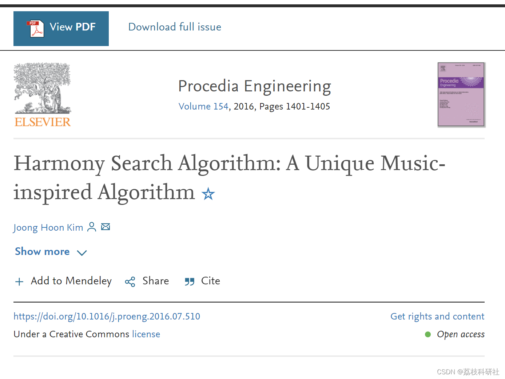
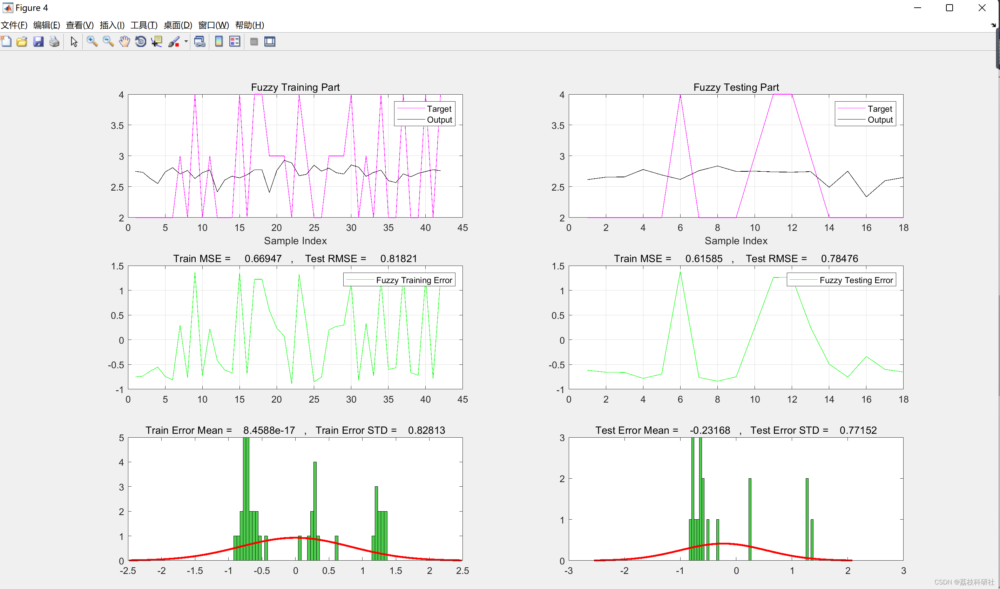
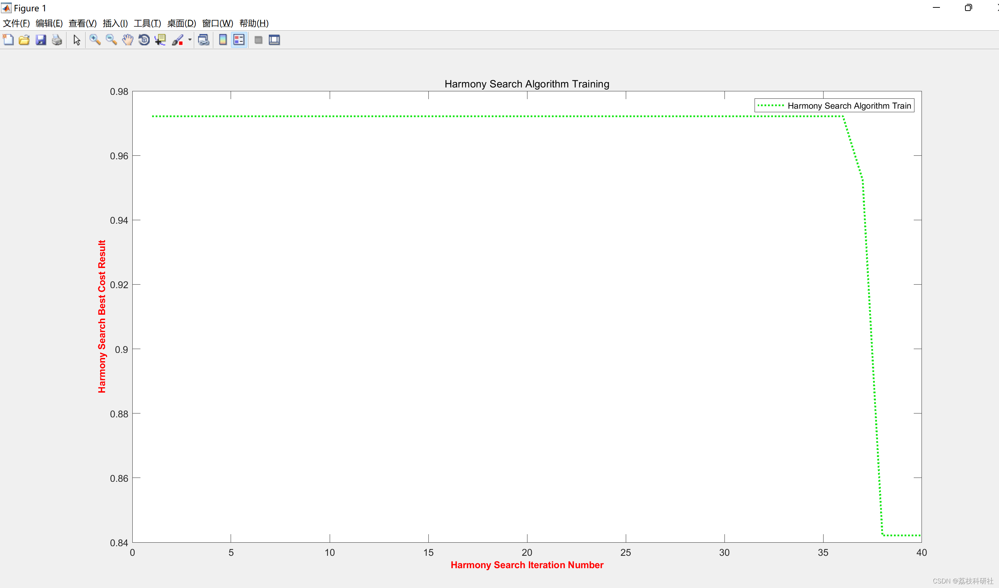
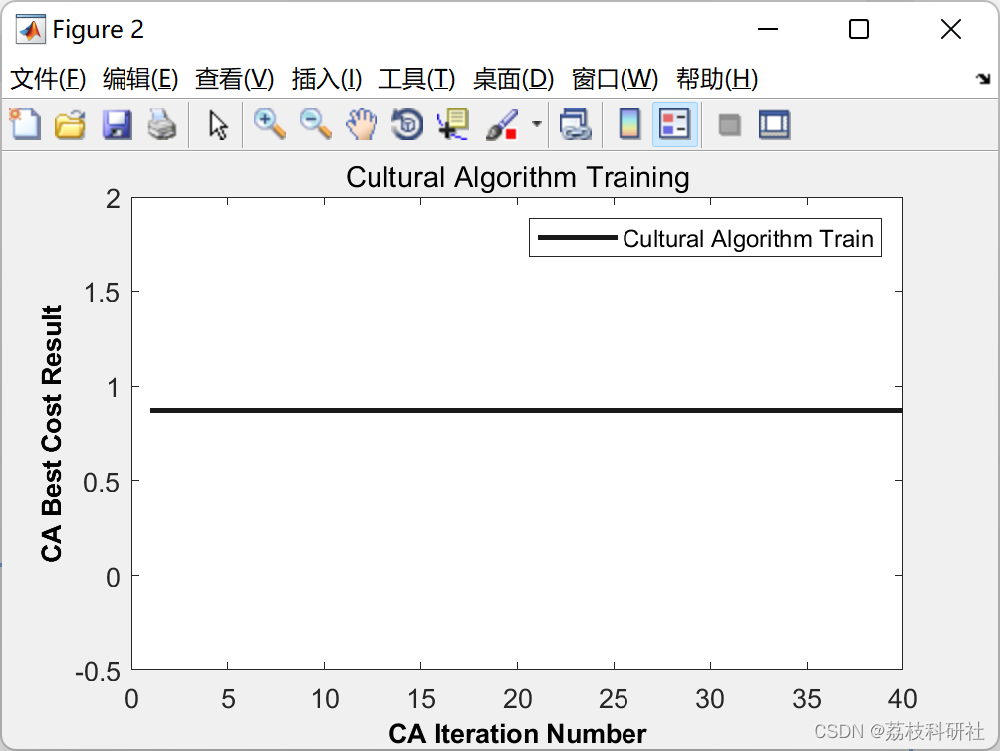
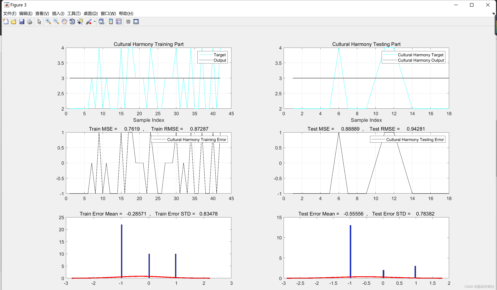

# Learning by combining cultural algorithms with harmony search using fuzzy logic (Matlab code implementation)

​  
Editor
Since its introduction in 2001, the Harmony Search Algorithm (HSA) has attracted worldwide attention due to its balanced exploration and exploitation, as well as its ease of application. Inspired by the process of musical performance, HSA consists of three operators: random search, harmony memory considering rules, and pitch adjustment rules. The use of these three operators to handle exploration and development makes HSA a unique metaheuristic algorithm. However, a recent author published a series of papers insisting that HSA is equivalent to Evolution Strategies (ES). ES, based on the ideas of adaptation and evolution, consists of two operators: recombination and mutation. Apart from the similarity in generating individual new solutions in each iteration replacing the worst solution overall, other components of HSA and ES are completely different, such as their exploration and exploitation strategies and structures. This paper aims to refute and point out the academic flaws in the paper.
📚2 Running Results Editing
Editor
Editor
Edit the code section:
%% Plot Cultural Harmony Results (Train - Test)  
% Train Output Extraction  
TrTar=data.TrainTargets;  
TrainOutputs=evalfis(data.TrainInputs,CAHSfis);  
% Test Output Extraction  
TsTar=data.TestTargets;  
TestOutputs=evalfis(data.TestInputs,CAHSfis);  
% Train calc  
Errors=data.TrainTargets-TrainOutputs;  
MSE=mean(Errors.^2);RMSE=sqrt(MSE);  
error_mean=mean(Errors);error_std=std(Errors);  
% Test calc  
Errors1=data.TestTargets-TestOutputs;  
MSE1=mean(Errors1.^2);RMSE1=sqrt(MSE1);  
error_mean1=mean(Errors1);error_std1=std(Errors1);  
% Train  
figure('units','normalized','outerposition',[0 0 1 1])  
subplot(3,2,1);  
plot(data.TrainTargets,'c');  
hold on;  
plot(TrainOutputs,'k');legend('Target','Output');  
title('Cultural Harmony Training Part');xlabel('Sample Index');grid on;  
% Test  
subplot(3,2,2);  
plot(data.TestTargets,'c');  
hold on;  
plot(TestOutputs,'k');legend('Cultural Harmony Target','Cultural Harmony Output');  
title('Cultural Harmony Testing Part');xlabel('Sample Index');grid on;  
% Train  
subplot(3,2,3);  
plot(Errors,'k');legend('Cultural Harmony Training Error');  
title(['Train MSE =  ' num2str(MSE) ' ,  Train RMSE =  ' num2str(RMSE)]);grid on;  
% Test  
subplot(3,2,4);  
plot(Errors1,'k');legend('Cultural Harmony Testing Error');  
title(['Test MSE =  ' num2str(MSE1) ' ,  Test RMSE =  ' num2str(RMSE1)]);grid on;  
% Train  
subplot(3,2,5);  
h=histfit(Errors, 50);h(1).FaceColor = [.1 .2 0.9];  
title(['Train Error Mean = ' num2str(error_mean) ' , Train Error STD = ' num2str(error_std)]);  
% Test  
subplot(3,2,6);  
h=histfit(Errors1, 50);h(1).FaceColor = [.1 .2 0.9];  
title(['Test Error Mean = ' num2str(error_mean1) ' , Test Error STD =  ' num2str(error_std1)]);  
%% Plot Just Fuzzy Results (Train - Test)  
% Train Output Extraction  
fTrainOutputs=evalfis(data.TrainInputs,fis);  
% Test Output Extraction  
fTestOutputs=evalfis(data.TestInputs,fis);  
% Train calc  
fErrors=data.TrainTargets-fTrainOutputs;  
fMSE=mean(fErrors.^2);fRMSE=sqrt(fMSE);  
ferror_mean=mean(fErrors);ferror_std=std(fErrors);  
% Test calc  
fErrors1=data.TestTargets-fTestOutputs;  
fMSE1=mean(fErrors1.^2);fRMSE1=sqrt(fMSE1);  
ferror_mean1=mean(fErrors1);ferror_std1=std(fErrors1);  
% Train  
figure('units','normalized','outerposition',[0 0 1 1])  
subplot(3,2,1);  
plot(data.TrainTargets,'m');hold on;  
plot(fTrainOutputs,'k');legend('Target','Output');  
title('Fuzzy Training Part');xlabel('Sample Index');grid on;  
% Test  
subplot(3,2,2);  
plot(data.TestTargets,'m');hold on;  
plot(fTestOutputs,'k');legend('Target','Output');  
title('Fuzzy Testing Part');xlabel('Sample Index');grid on;  
% Train  
subplot(3,2,3);  
plot(fErrors,'g');legend('Fuzzy Training Error');  
title(['Train MSE =  ' num2str(fMSE) ' ,  Test RMSE =  ' num2str(fRMSE)]);grid on;  
% Test  
subplot(3,2,4);  
plot(fErrors1,'g');legend('Fuzzy Testing Error');  
title(['Train MSE =  ' num2str(fMSE1) ' ,  Test RMSE =  ' num2str(fRMSE1)]);grid on;  
% Train  
subplot(3,2,5);  
h=histfit(fErrors, 50);h(1).FaceColor = [.3 .8 0.3];  
title(['Train Error Mean =  ' num2str(ferror_mean) ' , Train Error STD =  ' num2str(ferror_std)]);  
% Test  
subplot(3,2,6);  
h=histfit(fErrors1, 50);h(1).FaceColor = [.3 .8 0.3];  
title(['Test Error Mean =  ' num2str(ferror_mean1) ' , Test Error STD =  ' num2str(ferror_std1)]);  
🌈3 Matlab code implementation
🎉4 References

## Images

<!-- PAYMENT_BLOCK -->

## Get this dataset

- Payment link (Stripe): [Buy now](https://buy.stripe.com/3cs8yP7sY87d0vu9AB)
- Payment QR code: 

<!-- /PAYMENT_BLOCK -->
